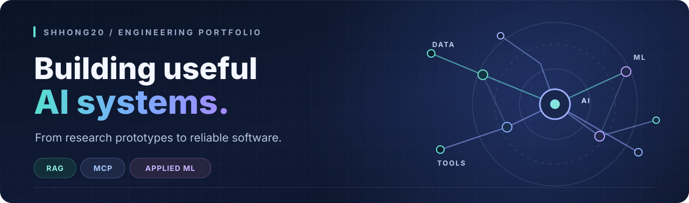

<!-- Profile README for github.com/shhong20. All featured links point to public repositories. -->

  

  <h3>AI Systems Engineering &nbsp;·&nbsp; LLM Infrastructure &nbsp;·&nbsp; Applied Machine Learning</h3>
  
Hi, I'm <b>shhong20</b>. I turn ideas into working AI systems — with a focus on reliable pipelines, evaluation, and tools people can actually use.

  
AI 모델을 연구하고, 실제로 작동하는 시스템으로 연결하는 개발자입니다.

  
  

 

## What I build

| | Focus | What matters to me |
| :---: | --- | --- |
| 🧠 | **LLM & RAG systems** | Retrieval, grounded responses, evaluation, and robust orchestration |
| 🔗 | **AI tools & MCP** | Practical agent integrations, safe remote operations, and auditable workflows |
| 🎧 | **Applied machine learning** | Audio understanding, classification, and reproducible experiments |
| ⚙️ | **Production-minded engineering** | APIs, data pipelines, testing, observability, and automation |

## Tech I work with

  
  
  
  
  
  
  
  
  

## Selected open-source projects

<table>
  <tr>
    <td width="50%" valign="top">
      <h3><a href="https://github.com/shhong20/Remote-MCP-Commander">🔐 Remote MCP Commander</a></h3>
      
A self-hosted bridge connecting MCP clients with authorized remote machines. Designed around device enrollment, narrow permissions, approval gates, and auditability.

      
<code>Python</code> <code>MCP</code> <code>Remote agents</code> <code>Security</code>

    </td>
    <td width="50%" valign="top">
      <h3><a href="https://github.com/shhong20/FreeQuantLab">📈 FreeQuantLab</a></h3>
      
A local research lab for strategy testing, time-series experiments, walk-forward evaluation, and simulated trading. Research-only — not an automated live trader.

      
<code>Python</code> <code>ML</code> <code>Backtesting</code> <code>Research</code>

    </td>
  </tr>
  <tr>
    <td width="50%" valign="top">
      <h3><a href="https://github.com/shhong20/KIS_MCP_Sever">🏦 KIS MCP Server</a></h3>
      
MCP tooling for read-only portfolio and brokerage-data workflows, with explicit safeguards around credentials, financial data, and unsupported operations.

      
<code>Python</code> <code>MCP</code> <code>Read-only APIs</code>

    </td>
    <td width="50%" valign="top">
      <h3><a href="https://github.com/shhong20/Namuh_MCP_Sever">🔌 Namuh MCP Server</a></h3>
      
An MCP-oriented integration project around NH investment Open API workflows, focused on making market-data and account tools accessible to AI clients.

      
<code>Open API</code> <code>MCP</code> <code>Tool integrations</code>

    </td>
  </tr>
</table>

## How I approach engineering

> **Make it work. Prove that it works. Make failure understandable.**

I care about clear system boundaries, meaningful tests, measurable quality, and designing for imperfect real-world data. My interests span model architecture, retrieval systems, multimodal learning, and developer infrastructure.

  Thanks for visiting. Explore my public repositories and feel free to open an issue or discussion where appropriate.

